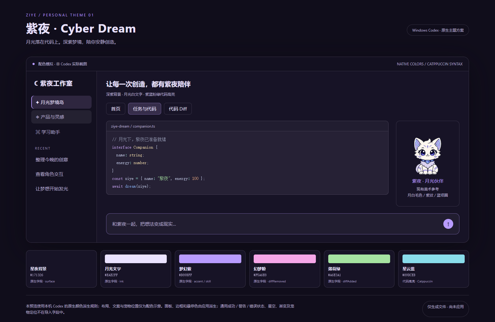

# 紫夜 · Cyber Dream

**月光落在代码上。**

「紫夜 · Cyber Dream」是一套为 Windows Codex 桌面版设计的深紫梦幻主题。灵感来自桌面伙伴紫夜的月白毛色、紫色纹样和蓝色项圈：用星夜深紫铺开工作空间，以月光白保证文字清晰，再用薰衣草紫、幻梦粉和薄荷绿点亮交互与代码变更。代码高亮沿用 Catppuccin Mocha，让紫夜和编程界面拥有协调的视觉语言。

主题使用应用原生的 `codex-theme-v1:` 分享格式，附带可复制的导入文本、配色预览和恢复说明。适合喜欢深紫配色，希望日常工作界面与桌面宠物相呼应的用户。

> 上图为配色模拟，不是 Codex 实际截图；宠物的位置、文案与布局仅用于展示颜色关系。此仓库为个人主题项目，与 OpenAI 官方没有隶属关系。

## 下载与导入

1. 打开设置 → 外观，在深色主题栏点击 **复制主题**，先保存当前主题的完整分享文本，并记下原来的 System / Dark / Light 模式。
2. 打开 [`theme/Ziye-Cyber-Dream.codex-theme.txt`](theme/Ziye-Cyber-Dream.codex-theme.txt)，复制全部内容，包括 `codex-theme-v1:` 前缀。
3. 在 **深色主题** 栏点击 **导入**，粘贴并提交。
4. 若当前系统为浅色，把模式切换为 **深色 / Dark** 以显示本方案。

导入会替换当前深色主题槽位的配色及字体覆盖。原生格式没有自定义显示名称字段，因此主题选择器仍可能显示 **Catppuccin**。详细步骤见 [导入与恢复说明](docs/INSTALL.md)。

想先查看配色，可以下载 [`preview/preview.html`](preview/preview.html) 并在本地打开；页面支持首页、任务与代码、Diff 三个视图，复制按钮不会修改 Codex。

## 配色

| 用途 | 色值 |
|---|---|
| 星夜背景 | `#171326` |
| 月光文字 | `#EAE2FF` |
| 梦幻紫强调 / 技能色 | `#B89BFF` |
| 幻梦粉 · Diff 删除 | `#F5A6E8` |
| 薄荷绿 · Diff 新增 | `#A6E3A1` |
| 代码高亮 | 内置 Catppuccin Mocha |

正文与主背景的对比度约为 **14.53:1**。该数值只针对指定颜色组合，不表示整套应用所有组件都通过无障碍认证。

## 原生能力与限制

- 支持背景、文字、强调色、Diff 增删色和技能色。
- 面板、边框、悬停和按下色由应用的原生规则派生，不能逐项独立指定。
- 语法颜色引用内置 Catppuccin Mocha，分享串不携带自定义 TextMate token 表。
- 不包含星空壁纸、渐变边框、动态光效、宠物动画或宠物定位修改。
- 选中文字和普通成功 / 警告 / 错误状态没有独立的主题导入字段。
- 导入可能同步账号的命名强调色；如需完全恢复，请同时保留原账号强调色选项。

## 兼容性

已在 Windows 安装包 `OpenAI.Codex 26.1103.7773.0` 中通过原生导入应用，并在外观页核对了 Catppuccin 预设和背景、文字、强调色。后续版本可能调整入口或规则。支持这些字段的桌面版是适用前提。

验证时保留了原来的“跟随系统”模式。示例预览中的所有页面布局与真实应用全流程并未逐项验收。仓库仅提供配色模拟图，实际设置截图保留在本地。

本项目不需要手工修改全局配置或注入 CSS。官方外观功能说明见 [OpenAI 文档](https://learn.chatgpt.com/docs/reference/settings#appearance)。

## 仓库内容

- `theme/`：原生分享文本与便于阅读的 JSON 参考。
- `preview/`：静态预览图与离线交互预览。
- `docs/INSTALL.md`：应用影响、导入步骤与恢复方法。
- `CHANGELOG.md`：版本说明。
- `SHA256SUMS.txt`：发布文件校验值。

仓库不包含个人配置、账号信息或用户的原主题备份。Catppuccin Mocha 由应用自身提供，本仓库不重新分发它的完整主题实现。
