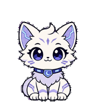
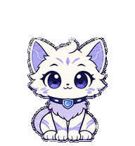
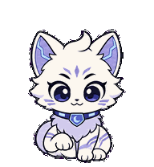
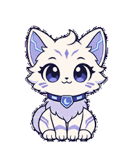
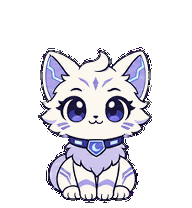
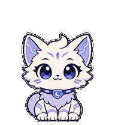

# 紫夜桌面宠物 · V2

紫夜是一只奶油白的小夜猫，戴着浅紫蓝月牙项圈。它会轻轻摇摆、眨眼、抬爪等待、交替点爪工作，在任务完成后低头查看，再抬头微笑。它与仓库中的「紫夜 · Cyber Dream」主题使用同一套月白、紫色和蓝色视觉。

这是现有紫夜宠物的公开分享包，保留原有角色和动画，没有重新绘制。

## 领养并应用（推荐）

**[打开紫夜原生分享页，添加到自己的宠物库](https://chatgpt.com/s/sharepet_6af4805890a08191819d2d2ce17e0f7a)**

1. 使用自己的 ChatGPT 账号打开上述链接，按页面提示确认添加 / 领养。
2. 在支持 Pets 的桌面版打开设置 → 宠物 / 迷你界面和智能伙伴，刷新列表并选择「紫夜」。
3. 通过应用提供的「显示宠物 / Show pet」入口显示桌面伙伴。

领养会得到自己的副本，不需要原作者的账号或配置。分享页是否可用、入口名称和桌面显示能力取决于应用版本、账号与工作区权限。这里没有替其他账号执行领养测试。

## 下载后应用

**[下载紫夜 V2 宠物包 ZIP](https://raw.githubusercontent.com/lisa-luo-yh/ziye-cyber-dream/refs/heads/pet/ziye-v2/pets/ziye/ziye-pet-v2.zip)** · [单独下载精灵图 PNG](https://raw.githubusercontent.com/lisa-luo-yh/ziye-cyber-dream/refs/heads/pet/ziye-v2/pets/ziye/spritesheet.png)

下载包包含透明精灵图、角色与动作说明、GIF 预览、原生分享地址、安装链接文本和校验值。

- **支持 V2 自定义精灵图上传的版本**：在宠物设置里上传解压后的 `spritesheet.png`，选择 V2（若有版本选项），名称填「紫夜」，完成后选中它。
- **支持桌面宠物安装链接的版本**：复制 `install-link.txt` 中的完整 `codex://pets/install?...` 地址到浏览器地址栏，允许打开已安装的桌面应用，再在应用的安装页确认。它使用仓库公开 PNG，显式指定 `spriteVersionNumber=2`。
- **安装链接没有反应**：优先使用上方原生分享页，或更新桌面版并检查 Pets 是否启用。GitHub 可能不把自定义协议渲染成可点击链接，因此安装地址作为文本提供。

安装链接格式依据 [OpenAI 官方深链接说明](https://learn.chatgpt.com/docs/reference/commands#pets)。如果上传入口仅接受 `1536×1872` 的 V1，请使用支持 V2 的桌面版本或原生领养入口；不要把本图拉伸或裁成 V1，这会丢失动作或视线行。

## 动作预览

| 状态 | 预览 |
|---|---|
| 等待输入 |  |
| 工作中 |  |
| 完成待看 |  |
| 受阻 |  |
| 跳跃 |  |

## 文件与规格

| 文件 | 用途 |
|---|---|
| `spritesheet.png` | 真正用于宠物安装的透明精灵图 |
| `pet.json` | 名称、描述、V2 格式与公开分享入口，供阅读和集成参考 |
| `animation-manifest.json` | 动作行与预览帧间隔说明 |
| `install-link.txt` | 指向公开 PNG 的桌面安装链接 |
| `领养紫夜.url` | Windows 快捷方式，打开原生 HTTPS 分享页 |
| `preview/*.gif` | 已有动作预览，不作为精灵图上传 |
| `validation.json` | 当前下载 PNG 的原生结构校验结果 |
| `SHA256SUMS.txt` | 包内文件的 SHA-256 校验值 |

精灵图为透明 PNG，`1536×2288` 像素，8 列 × 11 行；每格 `192×208`，73 个有效帧。前 9 行是动作，后 2 行是 16 个顺时针视线方向。

当前在线 PNG 的原生结构校验返回 `valid: true`，错误数为 0。在线 PNG 与已有最终素材编码不同，但解码后的像素逐一相同；GIF 预览沿用这套相同像素的最终素材。此核验不代表重新评审了全部动作语义。

## 能随包分享的设置

可分享的内容是角色名称、描述、V2 动画精灵图及动作映射。`pet.json` 和 `animation-manifest.json` 是参考清单，**不是可以直接写入应用全局配置的官方配置文件**。

动画实际播放速度、状态切换、宠物大小、桌面位置和是否显示由应用与接收者控制；GIF 的帧间隔仅用于预览。V2 待机为 6 帧；本包不实现“9 帧待机”“每 25 秒眨眼”或“每 5 分钟五连跳”等定时行为。

包内不包含聊天记录、账号信息、登录凭据、私人设备路径或作者的全局设置。请通过应用的原生宠物入口安装。
